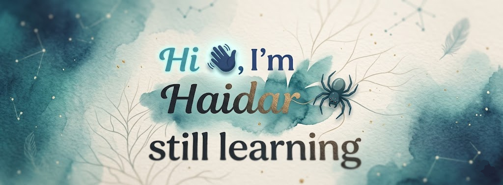

 

  

  <h1>Hi, I'm Vigilanterr</h1>
  
<strong>Full-Stack Developer · Web & Mobile Developer</strong>

  

    <a href="https://github.com/Vigilanterr">GitHub</a> ·
    <a href="https://www.instagram.com/ahdairaja/">Instagram</a> ·
    <a href="mailto:tiger191110@gmail.com">Email</a>
  

---

### About

I'm a developer focused on building web and mobile applications, with an interest in backend systems, database design, and user experience.

I enjoy turning ideas into practical products through clean code, thoughtful architecture, and continuous learning.

- Building full-stack web applications
- Developing mobile applications with Flutter
- Designing REST APIs and database structures
- Exploring modern web technologies and deployment workflows

### Tech Stack

**Languages**

  

**Frontend Development**

  

**Backend & Database**

  

**Mobile & Design**

  

**Tools & Platforms**

  

### Selected Projects

| Project | Description | Stack |
|---|---|---|
| **PASOKTANI** | Agritech platform connecting farmers directly with buyers. | Next.js, Node.js, PostgreSQL |
| **KompasDesa** | Digital platform supporting agricultural distribution and business connections. | Next.js, TypeScript |
| **Temuin** | Mobile application for managing lost and found items. | Flutter, Dart |

### GitHub

  
  

  

---

  
<strong>Let's build something meaningful.</strong>

  <a href="mailto:tiger191110@gmail.com">Get in touch</a>

